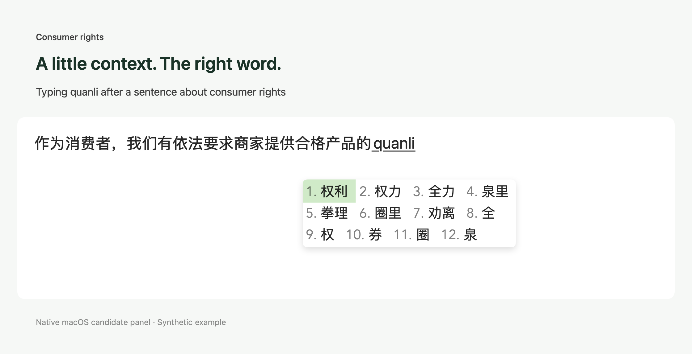

# Project Telepathy

**简体中文** · [English](README.en.md)


**让中文输入更懂上下文。**

Telepathy 是一款 macOS 原生中文输入法。照常输入拼音，小型本地模型会结合光标前的文字，帮你把合适的词语放到前面。输入过程在你的 Mac 上完成，无需账号或 API 密钥。

[下载最新版本](https://github.com/timothyzhutr/Project-Telepathy/releases/latest) · [使用指南（英文）](https://github.com/timothyzhutr/Project-Telepathy/blob/main/docs/user-guide.md) · [反馈问题](https://github.com/timothyzhutr/Project-Telepathy/issues)

Telepathy 目前仍是早期版本，支持 **搭载 Apple 芯片、运行 macOS 26.2 或更高版本的 Mac**。



## 功能

- **根据上下文排序。** Context prediction 使用本地 Qwen3.5 0.8B 模型，判断哪个词语更适合接在光标前的文字之后；Rime 和万象提供拼音转换及词库。
- **原生输入体验。** 在 Mac 应用中使用常规的拼音输入、键盘选词和原生候选窗口。
- **中英混输。** 可选的 Auto 模式根据上下文判断保留英文原文还是转换中文拼音。目前为实验性功能。
- **自动选择标点形式。** 在 Auto 模式中，根据句子语言使用中文或英文形式的逗号、引号等标点。
- **按习惯调整。** 分别设置参与排序的候选数量、每页显示数量和每行数量，也可以调整字号、外观、候选注释和模型辅助高亮。
- **首词语言提示。** 获得屏幕录制权限后，可在输入框激活时读取当前窗口截图，帮助判断最初应输入中文还是英文。后续由文字上下文接管；截图和文字共用一个模型。
- **本地推理。** 下载模型后，输入辅助可以离线使用；你的文字不会被发送到云端服务。

## 安装

不需要安装 Python、Homebrew 或开发工具。

1. 从 [Releases](https://github.com/timothyzhutr/Project-Telepathy/releases/latest) 下载并解压 macOS ZIP 文件。
2. 运行 **Install Telepathy.command**，并保持它与 **Telepathy.app** 位于同一文件夹。
3. 在 **系统设置 → 键盘 → 文本输入 → 编辑 → +** 中添加 **Telepathy**，然后从输入法菜单中选中它。如果暂时没有出现，请退出登录后重新登录。
4. 运行 **Download Model.command** 下载模型，也可以在终端执行：

   ```bash
   "$HOME/Library/Input Methods/Telepathy.app/Contents/MacOS/Telepathy" --download-model
   ```

模型文件约需 **650 MB 磁盘空间**，另外还需要应用本身的空间。v0.2 使用同一个支持视觉的模型完成候选排序、中英判断和首词截图提示，不会同时加载 Kev 与视觉模型。模型下载或加载期间，普通拼音输入仍然可用。更新时，安装程序会备份已有的 Telepathy 应用和配置；安装成功后保留最近两份备份。

当前版本使用临时签名（ad-hoc），尚未通过 Apple 公证。如果 macOS 阻止打开，请先尝试运行，再到 **系统设置 → 隐私与安全性** 中选择 **仍要打开**。更多安装说明见[故障排查（英文）](https://github.com/timothyzhutr/Project-Telepathy/blob/main/docs/troubleshooting.md)。

## 开始输入

选中 Telepathy，照常输入拼音即可。

| 操作 | 按键 |
| --- | --- |
| 选中高亮候选 | 空格 |
| 选中编号候选 | 对应数字键 |
| 浏览候选 | 方向键 |
| 手动输入英文原文 | Caps Lock |

用空格选中英文候选时，会自动在词后补一个空格，连续英文词之间不会重复插入分隔空格。

从输入法菜单打开 **Telepathy → Settings…**，可以调整候选窗口，或启用 **Automatic Chinese / English** 和 **Starting language from screen**。目前设置界面使用英文。v0.2 使用 Context prediction 排序；旧版 Kev decision ranking 不适用于新的视觉模型。模型实际参与评分时，当前选中的候选会使用青绿色高亮；可以通过 **Highlight model-assisted candidates** 关闭。

首次使用截图提示时，需要在设置中允许 Telepathy 进行屏幕录制，并按 macOS 提示重新打开输入法。设置界面会显示权限状态。Auto 模式会记住当前输入位置最近一次明确的中英判断，下一词立即沿用；新的文字上下文可以更新判断，暂时无法判断时保留原决定。移动光标、选中文字或切换输入框时重新判断。截图仅用于缺少前文时的初始提示，手动选择和后续文字上下文优先；连续输入不会逐词截图。如果提示尚未返回，普通拼音候选仍然可用。

默认对最多 **12 个候选排序，每页显示 6 个**。**Candidates to rank** 控制参与排序的数量，**Candidates to show** 控制每页显示的总数，**Candidates per row** 只控制排版；前两项可分别设置为 1–12。按 **Page Down 或 =** 查看其余候选，按 **Page Up 或 -** 返回。显示数量可以多于排序数量，未参与排序的候选保留原顺序。

你也可以从菜单关闭 **Local assistance**。关闭后，Rime 的普通候选仍然可用，模型辅助进程会停止并释放内存。重新开启时会加载模型，期间可以继续使用普通拼音输入。

Auto 模式在判断较有把握时保留英文原文；中文或不确定的输入仍会显示候选。按 **↓ 或 Tab** 可恢复当前词的中文候选；按 **Shift + 字母** 可开始输入英文原文，直到下一个空格。短词和上下文不足的情况仍可能误判。

模型只对 Rime/万象提供的候选排序。万象可以提供词句补全，模型可能将较长的补全候选排到前面；模型本身不生成新词句。即使所有候选都不合适，Context prediction 仍可能把其中一个排在前面。前文不足时会保留 Rime 的顺序。详细设置、标点行为和快捷键见[使用指南（英文）](https://github.com/timothyzhutr/Project-Telepathy/blob/main/docs/user-guide.md)。

## 隐私与资源占用

输入上下文在本机处理，不会发送到云端 API，也不会写入模型辅助进程的日志。开启截图提示并授予权限后，Telepathy 会在输入会话激活时读取当前应用窗口；所有应用和输入框共享 **5 秒截图冷却时间**。冷却结束时，只有仍在当前输入位置、首词尚未提交且缺少前文，才会截图；过期任务会取消。截图仅在内存中处理，不保存到磁盘、不上传，也不会连续录屏。可以单独关闭 **Starting language from screen**。目前未启用个人词库学习。模型下载命令会下载并校验固定版本的模型文件，之后的推理可离线运行。

Qwen3.5 通过 MLX / MLX-VLM 在 Apple GPU 上运行，使用 **4-bit 权重量化**。模型权重约占 **0.63 GB**；缓存、图像处理与推理运行时还会占用额外内存。此前在 M2 Pro 上的试测约有 1.3 GB 常驻占用，图像推理期间峰值更高，详见[单模型试测](experiments/screen-language/SINGLE-MODEL.md)。关闭辅助功能会停止模型进程并释放其内存。候选先显示，模型判断异步进行，无需等模型返回才能选词。

模型使用开始输入时光标前最多 100 个模型 token 的文字，不使用光标后的内容。应用无法提供前文时，会使用近期通过 Telepathy 输入的文字，判断可能不够准确。更多测量结果和已知限制见[资源与预测说明（英文）](https://github.com/timothyzhutr/Project-Telepathy/blob/main/experiments/prediction/README.md)。

## 参与开发

想从源码构建或贡献代码，可以从[构建指南（英文）](https://github.com/timothyzhutr/Project-Telepathy/blob/main/docs/development.md)开始。欢迎反馈问题、应用兼容性情况，或提交聚焦具体改进的 Pull Request。反馈问题时，请附上 macOS 版本、使用的应用和复现步骤；输入示例请使用你愿意公开的内容。

## 致谢与许可证

Telepathy 建立在 **鼠须管 / Squirrel、Rime、万象、RIME-LMDG、Qwen、MLX、MLX-VLM** 及 Python 生态的工作之上，早期候选排序还使用了 Kev。截图判断参考了 OpenJev 的选项标签读出方法。感谢这些项目的作者与贡献者。各组件的来源、用途和许可证见 [CREDITS.md](CREDITS.md)；应用内也提供原生的 Credits 和 Licenses 窗口。

Telepathy 的应用与集成代码使用 [GPL-3.0](LICENSE) 许可证。依赖组件与模型权重保留各自的许可证。模型权重单独下载，不包含在应用或源码仓库中。
